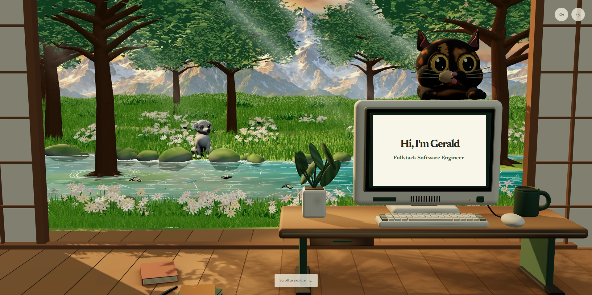

# PORTFOLIO

### Visit my portfolio: 

# SELECTED PROJECTS

### Xtreme Canopies: Shopify Website & Custom Quote Experience

* Built and maintained the Shopify website, including rebuilding the Custom Modular Canopy page as an interactive product configuration and quotation flow.
* Rerouted the existing automated email function and created a Supabase database from scratch to store customer and quote information for the marketing team.

### BHUMBLE: Financial Literacy & Web3 Learning Platform

* Built the platform from the ground up, including the frontend, database, authentication and authorization, lessons, and payment integrations.
* Created an e-learning experience introducing users to financial literacy, Bitcoin, and Web3.

### MRDN Auctions: Luxury Watch Bidding Platform

* Took over the existing production platform after the owner changed developers and helped make it production-ready.
* Integrated Xendit payments, stabilized real-time bidding, and ensured auction winners, payment statuses, and transaction records were saved correctly.

### Hair Health Institute: WooCommerce Funnel

* Delivered a production WordPress/WooCommerce funnel with secure attribution and analytics integrations.

### Mommy AR Cakes: Custom Website

* Built a custom website for the cake business.

### The Dome: Company Website & CMS Rebuild

* Worked on a company website rebuild with a CMS.
* This is an unfinished preview; the project was discontinued before launch.

# PROJECTS FOR FUN

### FlowState: No-Code Website Builder

* Built a full visual website builder where template selection, drag-and-drop editing, and deployment complete in minutes.
* Integrated asset search, one-click Vercel deployment with real-time build log streaming, and dependency-free HTML/CSS export.

### ZanFlix: Free Movie Streaming Platform

* Built a streaming platform with curated categories and real-time TMDb-powered search.
* Implemented a TV show episode selector and an integrated video player for trailers and content.

### Tadhana: Interactive Tarot Reader

* Developed an immersive application featuring stunning WebGL-based effects, including a central Light Pillar and dynamic Aurora backgrounds.
* Built interactive deck shuffling, sequential card reveals, and a built-in AI interpreter (Nessy System Analyzer) that synthesizes spreads into comprehensive markdown summaries.

### Birds VS Hunters: 3D Android Game

* Engineered a custom OpenGL 3D rendering pipeline and game engine entirely from scratch using pure Java and Android NDK bindings, bypassing third-party frameworks.
* Implemented highly optimized mobile mechanics handling physics, rendering, audio, and entity management with efficient draw calls and custom Blender assets.

### AI Color Palette Generator

* Developed an intelligent utility application that programmatically generates cohesive color palettes for design and development workflows.
